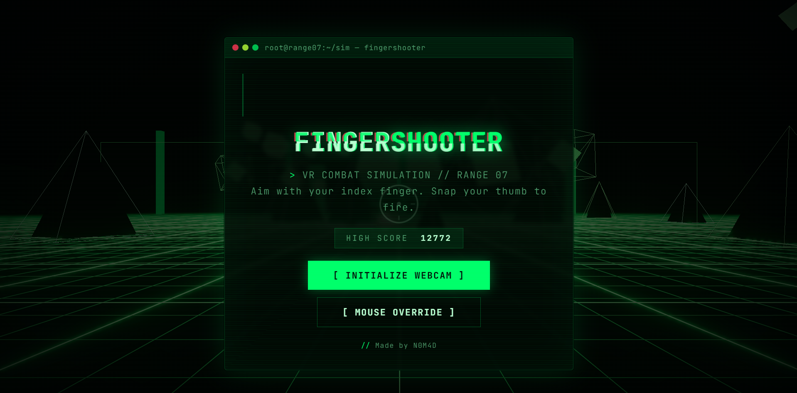
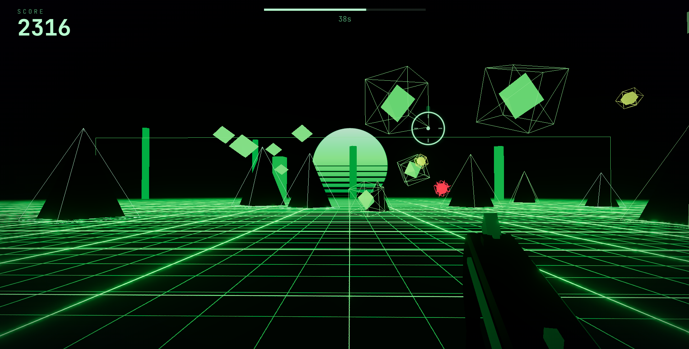

# FingerShooter

A first-person shooting-gallery web game with **Matrix-hacking vibes**. Aim a sci-fi energy pistol with your **index finger** and fire by **snapping your thumb** — a real finger-gun, tracked live through your webcam. Hand tracking runs entirely in-browser; no video ever leaves your machine.

[Play FingerShooter live](https://fingershooter.netlify.app/)

## Screenshots





## Quick start

```bash
npm install
npm run dev
```

Then open the printed local URL, hit `[ INITIALIZE WEBCAM ]`, allow camera access, and make a finger gun.

| Script            | What it does                          |
| ----------------- | ------------------------------------- |
| `npm run dev`     | Vite dev server with hot reload       |
| `npm run build`   | Typecheck + production build to `dist/` |
| `npm run preview` | Serve the production build locally    |
| `npm run typecheck` | `tsc --noEmit` only                  |

A modern browser with WebGL2 and webcam access is required (Chrome/Edge/Firefox). If the camera is blocked, `[ MOUSE OVERRIDE ]` plays the whole game with mouse aim + click to fire.

## Controls

| Action           | Hand mode                          | Mouse mode   |
| ---------------- | ---------------------------------- | ------------ |
| Aim              | Point your index finger            | Move mouse   |
| Fire             | Cock the thumb up, then snap it down | Left click |
| Cancel calibration | `ESC`                            | —            |
| Toggle debug pane (camera preview + gesture telemetry) | `D` | `D` |

**Calibration:** hold the aim pose steadily for a moment — the progress bar fills and the round starts automatically.

## Gameplay

- 60-second rounds; difficulty ramps as targets spawn faster and more densely.
- **Data crates** (wireframe cubes) — 100 points
- **Packets** (fast, orbiting) — 250 points
- **Firewall viruses** (spiked hazards) — **−150** points, don't shoot them
- Chain hits to build a combo multiplier (up to ×5); missing breaks the chain.
- Distance bonus for long-range hits. High score persists in `localStorage`.

## Tech notes

- **Vite 7 + TypeScript (strict) + three.js** for the WebGL scene (bloom, scrolling neon grid, procedural environment — no external 3D assets).
- **MediaPipe HandLandmarker** (`@mediapipe/tasks-vision`) runs WASM inference on a local video stream; the model and WASM binaries load from CDN on first use of hand mode (code-split, so mouse mode never downloads them).
- **Web Audio** synthesizes every sound procedurally (with a shared echo bus), except the gunshot, which uses `public/assets/freesound_community-shoot-2-81137.mp3` with a synth fallback until it decodes.
- Camera frames are processed locally in the browser tab. Nothing is uploaded.

## Project layout

```
src/
  main.ts            Game loop, modes, scoring glue
  game/              Arena (scene/bloom/grid), targets, gun viewmodel, juice FX
  tracking/          Hand tracker, gesture state machine, aim filter, debug pane
  ui/                Menu/HUD screens, Matrix digital-rain backdrop
  audio/             SFX kit (procedural + gunshot sample)
public/assets/       Gunshot sample
```

---

Made by N0M4D.
